# Results

What the experiments with crowdbook found. Every number and chart here comes from the scripts in
[`analysis/`](../analysis), run against the Release build. Every run is seeded, so the same
commands reproduce them exactly:

```bash
cmake --workflow --preset release
uv run --project analysis crowdbook-facts         # about 11 minutes on 10 cores
uv run --project analysis crowdbook-experiments   # a few seconds
uv run --project analysis crowdbook-large-orders  # about 2 minutes
uv run --project analysis crowdbook-trading-day   # a few seconds
uv run --project analysis crowdbook-prediction    # about half a minute
```

The comparison with real markets reads Polymarket's trades from the Polygon blockchain first;
the data is kept under `analysis/data`, so it is read once:

```bash
uv run --project analysis crowdbook-polymarket --from 2026-09-28 --to 2026-10-12  # an hour or two
uv run --project analysis crowdbook-fit           # about an hour on four cores
uv run --project analysis crowdbook-realism       # a few minutes
```

Uncertainties are standard errors across independent runs. Prices are in ticks, cents in the
prediction market, and PnL is in ticks per lot traded.

## The markets

The stylized facts come from two markets built around the same thousand zero-intelligence traders
(Farmer, Patelli and Zovko, 2005). Each of those traders sends 0.4 limit orders and 0.1 market
orders a second, of 1 to 10 lots, on random sides. Each resting order is cancelled after an
exponential lifetime of 5 seconds on average.

- **Mixed market** ([large_market.toml](../examples/scenarios/large_market.toml)), with 1,432
  agents: the thousand noise traders, plus two Avellaneda–Stoikov market makers, one on a 20 µs
  connection requoting every 50 ms and a slower one, twenty trend followers, and traders who
  follow the asset's true value, a random walk of 0.2 ticks per √second. Nobody sees that value
  exactly. Ten experts see it about a second late, each with a lasting error of half a tick, and
  400 followers about half a minute late, with errors of 1.5 ticks; the followers trade only when
  the price is at least 4 ticks from what each thinks the value is.
- **Noise traders only** ([large_noise.toml](../examples/scenarios/large_noise.toml)): the
  thousand noise traders on their own.

Each market ran for one simulated day under each of four seeds, sampling prices every second. It
also ran for one simulated hour under each seed with its event log, for spreads and price impact.
One simulated day of the mixed market is 17.5 million trades and takes 35 seconds on one core.

## What emerges

| Stylized fact of real markets (Cont, 2001) | Mixed market | Noise traders only |
|---|---|---|
| Tight spread | Yes: 1.58 ticks on average | Yes: 1.51 ticks |
| Mid price reverts at short horizons | Yes: lag-1 autocorrelation of 1 s returns is −0.37 | Yes: −0.41 |
| Returns uncorrelated beyond a few minutes | Not quite: −0.10 at 5 min, as the price is pulled back to value | Yes |
| Fat tails | Only around 10 s: excess kurtosis +0.85, gone by 1 min | No |
| Volatility clustering | Only around 10 s: absolute-return autocorrelation +0.24 at lag 1 | Barely: +0.04 |
| Price anchored to value at long horizons | Yes: volatility over an hour equals the true value's | No value to anchor to |
| Uninformed impact decays, informed impact stays | Yes | — |

In these two markets, two facts of real markets are missing (the [memory market](#memory-what-makes-volatility-cluster) brings them in). Fat tails and volatility clustering appear here only over
seconds, and fade within a minute. Real markets show fat tails at intraday and daily horizons, and
volatility clustering that lasts for weeks (Cont, 2001). Every agent here acts at a constant
average rate, and none remembers more than a few seconds of prices. Nothing can make a busy hour
follow a busy hour.

### Prices bounce at short horizons

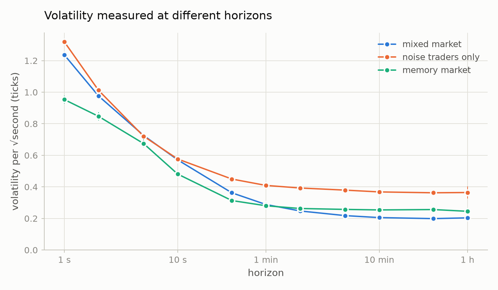

For a random walk, volatility per √second is the same at every horizon. Here it falls by a factor
of six in the mixed market, from 1.25 ticks at one second to 0.20 at an hour. The mechanism shows
in the [price impact](#who-moves-prices) below:
1. When a market order empties the best price level, the mid jumps.
2. Within a second, new limit orders land inside the widened spread and pull it back.

Real transaction prices give the same falling curve in a volatility signature plot (Andersen et
al., 2000), where the bid–ask bounce plays the part of the refilling book.

At long horizons the two markets part ways. The noise traders alone wander at 0.36 ticks per
√second. In the mixed market, the traders who follow the value hold the price to it, so it
settles at the value's own 0.20.

| Market | Trades per second | Mean spread | Volatility at 1 s | 10 s | 1 min | 10 min | 1 h |
|---|---:|---:|---:|---:|---:|---:|---:|
| Mixed market | 202 | 1.58 | 1.25 | 0.58 | 0.28 | 0.21 | 0.20 ± 0.01 |
| Noise traders only | 181 | 1.51 | 1.32 | 0.58 | 0.41 | 0.37 | 0.36 ± 0.04 |

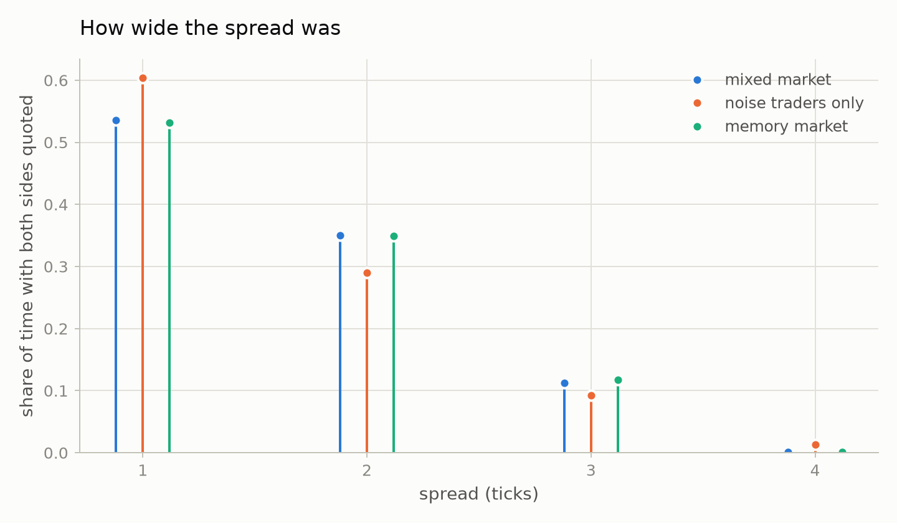

### Trend followers make bursts; traders who follow the value anchor the price

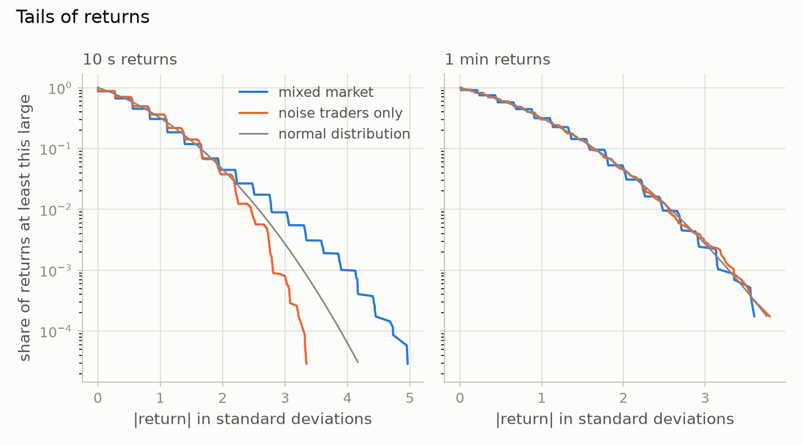

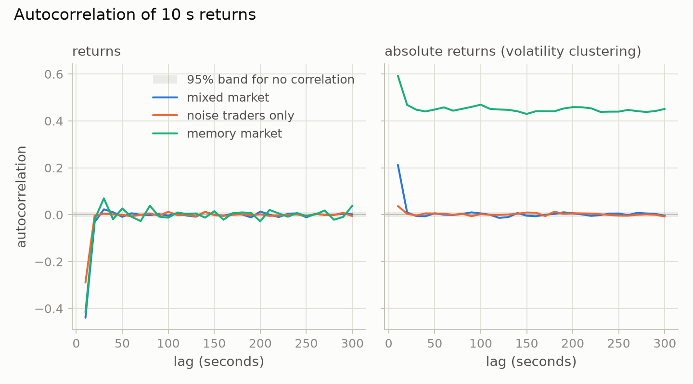

| Market | Excess kurtosis, 10 s | Excess kurtosis, 1 min | Absolute-return autocorrelation, 10 s | Absolute-return autocorrelation, 1 min | Volatility at 1 h |
|---|---:|---:|---:|---:|---:|
| Mixed market | +0.85 ± 0.03 | −0.07 ± 0.04 | +0.243 ± 0.006 | +0.082 ± 0.013 | 0.20 ± 0.01 |
| … without the market makers | +0.81 ± 0.06 | +0.05 ± 0.06 | +0.280 ± 0.005 | +0.085 ± 0.008 | 0.20 ± 0.01 |
| … without the trend followers | −0.25 ± 0.01 | −0.20 ± 0.04 | +0.125 ± 0.005 | −0.007 ± 0.017 | 0.20 ± 0.01 |
| … without the traders who follow the value | +0.57 ± 0.06 | −0.47 ± 0.03 | −0.129 ± 0.007 | +0.017 ± 0.016 | 0.35 ± 0.05 |
| Noise traders only | −0.31 ± 0.02 | −0.05 ± 0.07 | +0.037 ± 0.008 | +0.000 ± 0.027 | 0.36 ± 0.04 |

Leaving out one group at a time shows which agents shape the mixed market:

- **Trend followers** cause the fat tails and most of the clustering at 10 seconds. A move of a
  tick or so sets all twenty buying together, which extends the move and adds a burst of
  volatility. Without them, 10-second returns are thinner-tailed than normal, like the noise
  market's.
- **The traders who follow the value** anchor the price. Without them, long-run volatility
  returns to the noise market's 0.36. The trend followers' runs then go uncorrected, and the
  market behaves strangely: one-minute returns are much thinner-tailed than normal (−0.47), and
  absolute returns are anti-correlated at 10 seconds. That regime deserves a closer look.
- **The market makers** change little. The fast one trades 63 lots a second and the slow one 3,
  against 1,125 for the noise traders.

Even the mixed market's 10-second tails are mild. Real intraday returns are far more heavy-tailed,
with excess kurtosis often in the tens (Cont, 2001).

### Who makes money

| Trader | Lots traded per second | PnL per lot, positions at the true value |
|---|---:|---:|
| Market maker | 63.3 | +0.620 ± 0.003 |
| Slow market maker | 3.2 | +1.250 ± 0.016 |
| Noise traders | 1,125.2 | +0.072 ± 0.004 |
| Trend followers | 50.3 | −3.352 ± 0.010 |
| Experts | 23.2 | +1.36 ± 0.14 |
| Followers | 15.5 | +0.86 ± 0.09 |

Trading is zero-sum, and the trend followers pay for everyone else. They lose 3.4 ticks on every
lot. That funds the traders who follow the value and the market makers, and even leaves the noise
traders slightly ahead. The experts, quicker and closer to right, earn more on each lot than the
followers. The slow market maker quotes wider and trades a twentieth as much as the fast one, but
earns twice as much a lot.

### Who moves prices


The chart measures how far the mid moves in an order's direction after it takes liquidity. The
averages run over four hours of the mixed market, with errors taken across the four runs.

| Trader | Aggressive orders | 1 ms | 100 ms | 1 s | 10 s | 1 min | 2 min |
|---|---:|---:|---:|---:|---:|---:|---:|
| Noise | 1,443,498 | +0.13 | +0.07 | +0.02 | +0.00 | +0.00 | +0.01 |
| Trend | 140,522 | +0.07 | +0.06 | +0.13 ± 0.02 | −2.31 ± 0.05 | −2.31 ± 0.07 | −2.35 ± 0.05 |
| Experts | 76,377 | +0.22 | +0.55 | +1.02 ± 0.01 | +1.99 ± 0.07 | +1.94 ± 0.06 | +1.87 ± 0.07 |
| Followers | 48,015 | +0.21 | +0.49 | +0.88 ± 0.01 | +1.65 ± 0.05 | +1.45 ± 0.08 | +1.48 ± 0.08 |

- **Noise orders** have purely transient impact. They move the mid a tenth of a tick, and the
  move is gone within a second.
- **Orders from traders who follow the value** have permanent impact. The mid keeps moving their
  way for ten seconds as others reach the same conclusion, and stays there: about two ticks on
  for the experts, and one and a half for the followers, whose view is half a minute old and less
  accurate.
- **Trend followers' orders** arrive as a move ends. Within ten seconds the price has gone two
  ticks against them, which is where their losses come from.

This is the textbook split between informed and uninformed flow (Kyle, 1985; Glosten and Milgrom,
1985). Here it comes out of the agents' behaviour; nothing in the model assumes it.

### Does the number of agents matter?

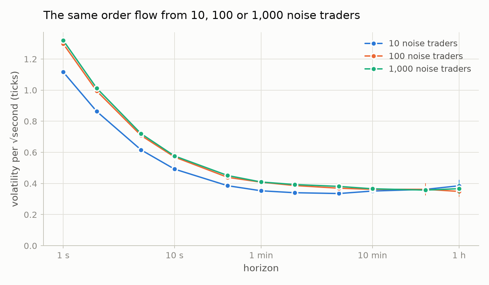

The same total flow (400 limit and 100 market orders a second) was split among 10, 100 or 1,000
noise traders, with unlimited positions, for four simulated days each:

| Noise traders | Orders per trader per second | Trades per second | Mean spread | Lag-1 autocorrelation at 1 s | Volatility at 1 s | Volatility at 10 min | Excess kurtosis at 1 min |
|---:|---:|---:|---:|---:|---:|---:|---:|
| 10 | 50 | 152.9 | 1.398 | −0.405 | 1.117 | 0.351 ± 0.015 | −0.13 ± 0.04 |
| 100 | 5 | 178.6 | 1.502 | −0.412 | 1.299 | 0.362 ± 0.010 | −0.18 ± 0.06 |
| 1,000 | 0.5 | 181.3 | 1.512 | −0.412 | 1.320 | 0.366 ± 0.011 | −0.05 ± 0.07 |

From 100 traders up, headcount makes almost no difference: spread and volatility agree within 2%.
Independent traders acting at random times add up to one random stream with the summed rate,
however the flow is divided.

With 10 traders, one difference appears, and it is mechanical: self-trade prevention. An agent's
market order meets its own resting order and is cancelled. A ten-minute run of each crowd (the
scenarios are in `stylized_facts.py`) with `--log-only trade,cancelled` counts 17 such
cancellations a second with 10 traders, 1.8 with 100 and 0.2 with 1,000. So 16% fewer trades
print, the spread is tighter and 1-second volatility is lower.

What makes market behaviour is what agents react to, not how many there are. The thousand
independent noise traders show no fat tails at all. Twenty trend followers reacting to the same
price do.

### Memory: what makes volatility cluster

[memory_market.toml](../examples/scenarios/memory_market.toml) is the mixed market with news
(a 6-tick jump in the true value every 30 minutes on average) and noise traders who react to the
market: their pace follows recent activity against its usual level, and when prices have been
jumping more than usual they place their limit orders further from the best prices. Its experts
and followers are the mixed market's; at their limits of 5,000 and 1,000 lots they ended every day
with room to spare.

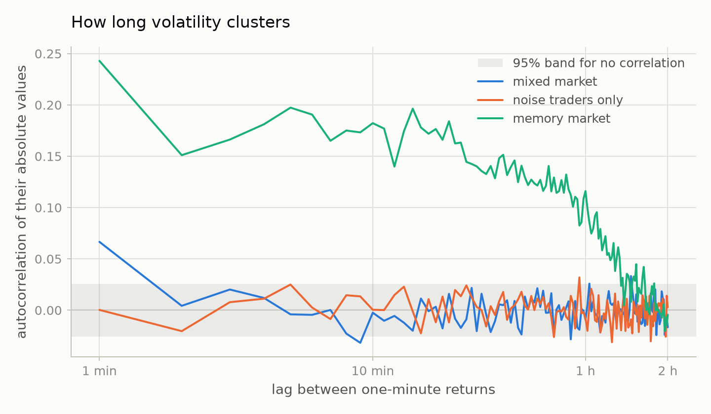

| Market | Excess kurtosis, 1 min | Clustering at 1 min | 15 min | 1 h | 2 h |
|---|---:|---:|---:|---:|---:|
| Memory market | +6.9 ± 0.6 | +0.38 | +0.25 | +0.13 | +0.00 |
| … without news | +6.4 ± 1.2 | +0.36 | +0.33 | +0.19 | +0.05 |
| … without the activity response | +6.2 ± 1.2 | +0.35 | +0.22 | +0.14 | +0.01 |
| … without the volatility response | +1.5 ± 0.3 | +0.07 | −0.00 | +0.02 | +0.01 |
| … with followers who act 2.5 ticks off | +3.0 ± 1.2 | +0.06 | −0.01 | −0.01 | −0.02 |
| … with fifty adaptive traders | +2.5 ± 0.3 | +0.07 | −0.02 | +0.01 | −0.01 |
| Mixed market, no memory | −0.1 | +0.08 | −0.00 | −0.00 | +0.00 |

"Clustering" is the autocorrelation of absolute one-minute returns at that lag; the 95% band for no
correlation is ±0.03. Tails thin with the horizon, as in real markets: excess kurtosis is +15 at
10 seconds, +6.9 at a minute and +1.7 at five minutes.

- **Liquidity feedback is the cause.** Without the volatility response the clustering is gone.
  Jumpy prices make the noise traders stand back, a thinner book makes the next jump bigger, and
  volatile spells last about an hour.
- **Activity feedback does nothing:** a thousand traders already trade hundreds of times a
  second, so activity barely fluctuates (trades per minute varied by about 4%).
- **News is not needed.** Without it the tails are as fat and the clustering lasts longer.
- **A crowd that trades small differences cancels it.** When the followers trade the price back
  2.5 ticks from what each thinks the value, rather than 4, the clustering is gone. Their views
  are spread around the value, so between them they stand ready at every price near it: depth
  that does not thin when the noise traders step back, which breaks the loop. Fifty adaptive
  traders switching between value and trend strategies (Brock and Hommes, 1998) wipe it out too,
  perhaps the same way.
- Clustering fades by two hours, where in real markets it lasts weeks. Splitting the noise
  traders across memories of a minute, ten minutes and an hour did not stretch it further than
  judging "usual" over a day did.

## Large orders

Much of the volume in real markets comes from parent orders that brokers' algorithms cut into many
small child orders over minutes or hours. Two of the best-documented regularities of market
microstructure follow from that (Bouchaud, Farmer and Lillo, 2009): the signs of market orders stay
correlated over thousands of orders, and a parent order moves the price roughly as the square root
of its size.

[large_orders.toml](../examples/scenarios/large_orders.toml) has a hundred brokers working parents
among the thousand noise traders. Each broker takes one parent at a time, after a pause of 20
seconds on average, with a random side and a size from a Pareto tail, P(size > q) = (15 / q)^1.5,
capped at 5,000 lots. It trades the parent with a 3-lot market order every 200 ms, so a parent of
a hundred lots takes seven seconds and one of five thousand almost six minutes. The noise traders
send few market orders of their own (0.02 a second each), so three quarters of all market orders
are children of parents. Each child carries its parent's id into the event log, which is how the
analysis puts parents back together.

The market has no informed traders. In a trial in the mixed market, whose informed traders see the
true value and hold thousands of lots, the brokers' parents, which carry no information, moved the
price by less than half a tick on average at every size: the informed traders absorbed them.

Each case ran for an hour under 16 seeds, with its event log.

### The signs of market orders remember

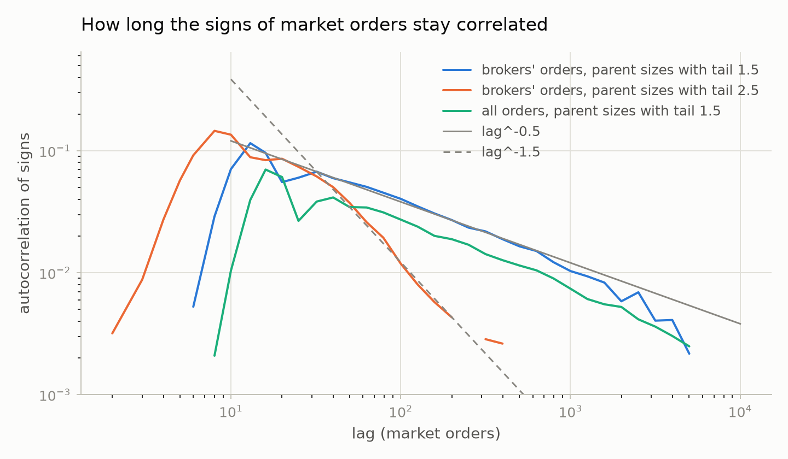

| Parent sizes | Orders | Lag 10 | Lag 100 | Lag 1,000 | Fitted exponent | Predicted |
|---|---|---:|---:|---:|---:|---:|
| Tail 1.5 | brokers' | +0.071 | +0.040 | +0.010 | 0.56 ± 0.03 | 0.5 |
| Tail 1.5 | all | +0.010 | +0.027 | +0.007 | 0.53 ± 0.02 | 0.5 |
| Tail 2.5 | brokers' | +0.135 | +0.012 | +0.001 | 1.53 ± 0.14 | 1.5 |
| Tail 2.5 | all | +0.055 | +0.011 | +0.000 | 1.32 ± 0.07 | 1.5 |

Lags count market orders. Standard errors of the correlations are about 0.001; the exponent of the
power-law decay is fitted over lags 32 to 2,500 (to a few hundred for the thinner tail, beyond
which its correlation is lost in noise), with its error from resampling whole runs.

- **The decay follows the tail of parent sizes.** Lillo, Mike and Farmer (2005) showed that when
  parent sizes have a Pareto tail with exponent α and many parents are worked at once, the
  correlation decays as lag^−(α−1). The simulation agrees with both tails it was given. With
  α = 1.5 the correlations decay so slowly that their sum diverges: long memory, as in real order
  flow. With α = 2.5 they die out within a few hundred orders.
- **The noise traders' orders dilute the correlation but leave its decay.** Their signs are
  independent, so the correlation of all orders is smaller, but it falls off at the same rate.
- **Consecutive orders are not correlated.** About a dozen parents are worked at once, each
  sending a child every 200 ms, so the next child of the same parent comes about a dozen orders
  later. In real markets the correlation is strongest at lag 1; their parents are worked more
  unevenly than this fixed-pace TWAP.

### Impact: the square root needs a book that remembers

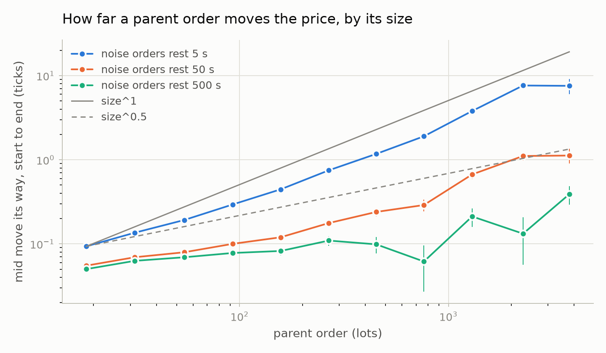

| Noise traders' orders rest | Parents | 15–30 lots | 150–300 lots | 1,500–5,000 lots | Fitted exponent |
|---|---:|---:|---:|---:|---:|
| 5 s | 188,021 | +0.10 ± 0.00 | +0.56 ± 0.02 | +7.4 ± 0.6 | 0.90 ± 0.02 |
| 50 s | 188,021 | +0.06 ± 0.00 | +0.14 ± 0.01 | +1.1 ± 0.1 | 0.60 ± 0.02 |
| 500 s | 188,021 | +0.05 ± 0.00 | +0.09 ± 0.01 | +0.20 ± 0.05 | 0.20 ± 0.08 |

Impact is the mid's move in the parent's direction from just before its first child to its last
fill, in ticks. The exponent is fitted to the mean impact in size bins holding at least 50 parents.
The brokers draw the same parents in all three markets, so the rows differ only in the market.

- **With the noise traders' usual 5-second orders, impact is almost linear in size** (exponent
  0.90 ± 0.02), not the square root of real markets.
- **The longer resting orders last, the more concave impact becomes:** an exponent of
  0.60 ± 0.02, near the square root, when they rest for 50 seconds, and 0.20 ± 0.08 at 500
  seconds.
- This is what theories of latent liquidity predict (Tóth et al., 2011; Donier et al., 2015). A
  book that remembers where the price has been holds orders a parent has to eat through, and
  they thin out toward the current price, which bends impact into a square root. A book that
  renews itself faster than the parent trades meets every child with fresh orders around the
  current price, so each child moves the price about as far as the last, and impact adds up
  linearly. Here a parent of a thousand lots takes about a minute: longer than a 5-second book
  remembers, shorter than a 500-second one.
- Longer-lived orders also make the book deeper, since the noise traders keep placing orders at the
  same rate, so these runs change the book's depth and its memory together. Separating the two,
  and measuring how much of the impact stays after a parent ends, are open.

## The trading day

[trading_day.toml](../examples/scenarios/trading_day.toml) trades the way a stock exchange's day
goes: a one-minute opening auction, continuous trading, a one-minute closing auction, and halts
when a trade lands more than 15 ticks from the last auction's price. Sixty noise traders follow a
U-shaped activity curve, 1.8 times their average pace at the open and the close and 0.6 times at
midday; two market makers, five trend followers, two experts and thirty followers who see the
true value late, and five brokers working parents by the same curve (VWAP) trade among them. The curve is an assumption, stated in the
scenario, like the U shape of real exchanges' volume it imitates; what follows from it is
measured. Each day ran for six and a half hours under 16 seeds, with the curve and with a flat
one, and the continuous session was cut into thirteen half hours.

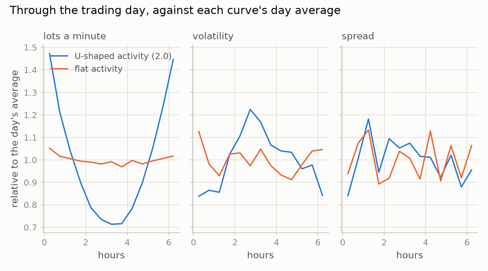

| activity | measure | first third | middle third | last third | first / middle |
|---|---|---:|---:|---:|---:|
| U-shaped (2.0) | volume (lots a minute) | 1,529 | 1,041 | 1,637 | 1.47 |
| U-shaped (2.0) | volatility (ticks, one minute) | 2.90 | 3.48 | 2.95 | 0.83 |
| U-shaped (2.0) | spread (ticks) | 0.79 | 0.81 | 0.74 | 0.98 |
| flat | volume (lots a minute) | 1,443 | 1,405 | 1,427 | 1.03 |
| flat | volatility (ticks, one minute) | 3.11 | 3.00 | 3.03 | 1.04 |
| flat | spread (ticks) | 0.76 | 0.78 | 0.76 | 0.97 |

- **Volume takes the curve's shape**, as it must: the busy hours trade half as much again as
  midday.
- **Volatility takes the opposite shape.** It is a sixth lower in the busy hours than at
  midday, where on real exchanges it is highest at the open. The curve brings more noise traders'
  limit orders as well as their market orders, so the book is deepest when the market is busiest,
  and the orders of the trend followers, the traders who follow the value and the brokers, which
  do not follow the curve, move the price least then. An activity curve alone does not make the open volatile; in real
  markets that comes with the news that piled up overnight, which this market does not have.
- **Spreads hardly move** through the day, within a few percent either way.
- **The auctions are small.** In a full day of this market the auctions, those reopening after
  halts included, trade under half a percent of the volume; real closing auctions trade around a tenth, because index funds and brokers send
  their orders for the close. Here only noise traders send auction orders, and only as many as
  the market orders they would have sent in that minute.
- **Halts follow the drift.** With a 15-tick band the market halted 19 to 27 times a day under
  four seeds, each time restarting from the halt's auction price, as the true value wandered away
  from where the day began.

## Prediction markets

[prediction.toml](../examples/scenarios/prediction.toml) is a market on one yes-or-no question
that resolves in thirty minutes, starting at a coin flip. A share pays 100 if the answer is yes,
so the price is the market's probability, in cents. News arrives about every hundred seconds and
carries half of what decides the question; the true probability is worked out exactly from
everything so far. Nobody trades on it exactly. Six experts see it a couple of seconds late, each
with a lasting error of about 2 cents; thirty followers see it a minute late, with errors of about
6 cents; and eight partisans, half a minute late, see yes as 8 cents likelier than it is. Forty
noise traders, two market makers and five trend followers trade too. It ran under 400 seeds, as
it is and again with every trader who follows the probability seeing it exactly, and every thirty
seconds of each run the mid price and the true probability were set against how the question
resolved.

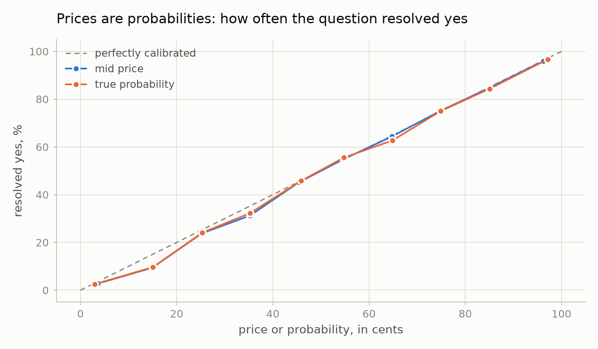

| price | as in the example: mean price | resolved yes | seeing it exactly: mean price | resolved yes |
|---|---:|---:|---:|---:|
| 0 to 10 | 4.5 | 1.7% | 3.6 | 2.7% |
| 10 to 20 | 15.1 | 6.1% | 14.9 | 9.5% |
| 20 to 30 | 25.3 | 16.9% | 25.2 | 23.8% |
| 30 to 40 | 35.2 | 28.5% | 35.2 | 31.4% |
| 40 to 50 | 45.4 | 43.8% | 45.4 | 45.1% |
| 50 to 60 | 54.4 | 54.2% | 54.6 | 54.9% |
| 60 to 70 | 64.8 | 63.9% | 64.8 | 63.8% |
| 70 to 80 | 74.8 | 76.5% | 74.9 | 75.3% |
| 80 to 90 | 84.9 | 87.0% | 84.9 | 84.9% |
| 90 to 100 | 96.1 | 96.8% | 96.3 | 96.1% |

Each version has about 23,600 moments, from 400 runs of which 51.7% resolved yes. Moments from one
run are alike, so they are worth far fewer independent forecasts.

| traders who follow the probability | Brier score | mean distance from the probability (cents) | priced 10 to 20: resolved yes | priced 80 to 90: resolved yes | trend followers' PnL per share |
|---|---:|---:|---:|---:|---:|
| as in the example | 0.162 | 4.76 | 6.1% | 87.0% | +3.88 |
| … without the partisans' tilt | 0.161 | 4.47 | 7.5% | 87.7% | +3.66 |
| … without lasting errors | 0.162 | 4.37 | 7.5% | 86.8% | +3.64 |
| … without delays | 0.159 | 2.92 | 7.9% | 85.5% | +0.91 |
| seeing it exactly | 0.160 | 2.14 | 9.5% | 84.9% | +0.04 |

The true probability, the best any trader could do, scores 0.158, and a coin flip 0.25. The Brier
score is the mean squared error of a forecast.

- **Traders who see the probability exactly make prices calibrated by construction.** Between
  them they know it, and every bin is within a few points of how often it resolved yes.
- **Late traders make a favourite–longshot bias.** As the example is, prices are still close to
  calibrated in the middle, but cheap shares are too dear and dear ones too cheap: of the moments
  priced 10 to 20, only 6% resolved yes, and of those priced 80 to 90, 87%. Real prediction and
  betting markets show the same pattern (Snowberg and Wolfers, 2010).
- **The delays cause it, not the partisans.** Taking away the partisans' tilt or the lasting
  errors changes little; taking away the delays brings the Brier score to the true probability's
  and halves the distance from it. A trader a minute late still sees the probability as it was,
  closer to 50 than where news has since taken it, and trades against the move. The price
  underreacts, which is also why the trend followers profit here, 3.9 cents a share, where in the
  mixed market above they lose: underreaction followed by momentum is what Hong and Stein (1999)
  derive from news that reaches traders gradually. Without the delays they earn nothing.
- **It needs informed traders with room to trade.** In a trial with three experts holding at
  most 300 shares each, they ran out of room late in the run, and the mid was about 8 cents from
  the probability in the last two fifths of the run; six with room for 600 hold it to about 5.

| group | PnL at resolution per share traded (cents) |
|---|---:|
| experts | +4.11 |
| partisans | +1.02 |
| followers | −0.36 |
| trend followers | +3.88 |
| market maker | +1.91 |
| slow market maker | −0.71 |
| noise traders | −1.11 |

The experts earn the most, as they should; the followers, a minute late, lose a little. The
partisans earn despite their tilt, being half a minute late rather than a minute. The slower
market maker, whose quotes stand a second, is picked off by news a little more often than it
earns the spread.

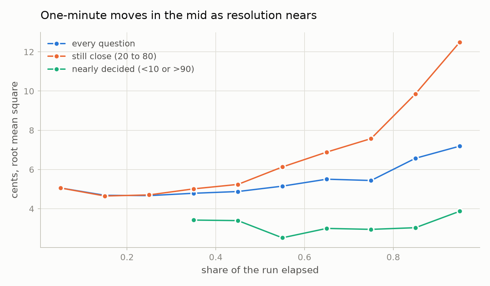

| tenth of the run | every question | still close (20 to 80) | nearly decided (<10 or >90) |
|---|---:|---:|---:|
| 1 | 5.06 | 5.06 | — |
| 3 | 4.67 | 4.70 | — |
| 5 | 4.88 | 5.24 | 3.39 |
| 7 | 5.51 | 6.89 | 2.99 |
| 9 | 6.57 | 9.86 | 3.03 |
| 10 | 7.19 | 12.50 | 3.87 |

- **Prices move fastest at the end, while the question is open.** In questions still between 20
  and 80, one-minute moves grow from 5 cents to 12.5 in the last tenth of the run: the same news
  moves the probability further the less time is left for anything to reverse it. That is how
  election-night markets and the last minutes of close games behave.
- **Questions nearly decided hardly move**, 3 to 4 cents a minute at any time. A price at 97 has
  nowhere to go.

## Real markets: Polymarket's Bitcoin questions

Every simulated statistic above was measured without anything real to hold it against. Here the
same statistics are measured on real prediction markets and on simulated ones, as a scorecard,
and the settings of a simulated market are fitted to the real ones.

The real markets are Polymarket's questions on whether Bitcoin will be up or down at the end of
the next five minutes, fifteen minutes or hour. Each opens at a coin flip with nothing known and
resolves at a known time, as a simulated prediction market does, and hundreds resolve every day.
Over the fifteen days from September 28 to October 12, 2026, there were 4,319 five-minute
questions, 1,439 of fifteen minutes and 359 hourly ones, with 8.2 million aggressive orders
between them from 33,280 wallets, for 253 million shares. Every trade settles on the Polygon
blockchain, and [`crowdbook-polymarket`](../analysis/src/crowdbook_analysis/polymarket.py) reads
them from there: one event for each order that took liquidity, with its side, size and price, and
how each question resolved. Which question is which comes from Polymarket's public list of
markets, checked against the chain.

The chain records trades but not the book, so every statistic is one trades alone give: the last
price at each moment, each aggressive order's size and side. A block comes every second or two
and gives the time a trade settled, a moment after it matched. Time is measured as a share of each
question's window, so that windows of five minutes, fifteen and an hour, and simulated ones, can
be set side by side.

For a value to set prices against, each real question's true probability is worked out from
Bitcoin's own price, Binance's one-second candles: the chance that a random walk with the
volatility of the hour before ends the window above where it began. The hourly questions resolve
on those very candles, and the value in a window's last second agrees with how the question
resolved 99.1% of the time. The shorter ones resolve on Chainlink's price, averaged over a
minute, which this value does not model: it agrees 93.4% of the time for fifteen minutes and only
85.0% for five, the roughest stand-in, and is left out of the charts.

[`crowdbook-realism`](../analysis/src/crowdbook_analysis/realism.py) prints the scorecard, with
the prediction example ([prediction.toml](../examples/scenarios/prediction.toml), thirty minutes)
and a market fitted to the fifteen-minute questions
([up_or_down.toml](../examples/scenarios/up_or_down.toml)), each under 400 seeds the fit never used.

| statistic | real, 5 min | real, 15 min | real, hourly | simulated: prediction | simulated: up_or_down |
|---|---:|---:|---:|---:|---:|
| questions | 4319 | 1439 | 359 | 400 | 400 |
| resolved yes | 50.2% | 49.3% | 49.9% | 45.2% | 47.8% |
| Brier score of the price | 0.127 | 0.150 | 0.161 | 0.165 | 0.157 |
| priced 10 to 20: resolved yes | 14.6% | 13.7% | 12.8% | 6.7% | 6.5% |
| priced 80 to 90: resolved yes | 85.6% | 85.3% | 89.3% | 87.6% | 83.0% |
| aggressive orders per minute | 279 | 71 | 13 | 482 | 89 |
| moves in the first tenth, close (cents) | 11.8 | 11.1 | 10.4 | 7.7 | 9.3 |
| moves in the last tenth, close (cents) | 47.9 | 44.1 | 39.1 | 26.3 | 34.8 |
| excess kurtosis of moves, close | 2.5 | 3.0 | 2.2 | 2.7 | 2.5 |
| orders in the first tenth | 12.1% | 8.1% | 14.4% | 13.0% | 10.9% |
| orders in the last tenth | 3.4% | 15.0% | 10.8% | 8.8% | 9.9% |
| largest tenth of orders against the median | 8.0 | 7.1 | 4.0 | 1.2 | 5.4 |
| tail exponent of order sizes | 1.41 | 1.39 | 1.18 | 3.27 | 1.30 |
| order signs, one apart | +0.23 | +0.30 | +0.27 | +0.08 | +0.33 |
| order signs, ten apart | +0.11 | +0.12 | +0.05 | +0.09 | +0.11 |
| successive price changes | −0.35 | −0.32 | −0.15 | −0.47 | −0.30 |
| spread implied (cents) | 3.5 | 3.2 | 1.6 | 1.2 | 2.9 |
| last price below 10 or above 90 | 99.7% | 99.8% | 95.3% | 75.8% | 92.0% |
| taker fees (cents a share) | 0.99 | 1.13 | 1.19 | 0.00 | 1.40 |
| value's moves in the first tenth, close (cents) | 12.6 | 14.2 | 14.8 | 10.3 | 10.3 |
| value's moves in the last tenth, close (cents) | 35.9 | 41.6 | 40.0 | 43.0 | 41.7 |
| excess kurtosis of the value's moves, close | 3.2 | 2.1 | 1.6 | 2.4 | 2.2 |
| Brier score of the value | 0.153 | 0.160 | 0.163 | 0.160 | 0.155 |
| distance from the value, close (cents) | 14.1 | 7.2 | 4.4 | 4.5 | 3.2 |
| price closest to the value as it was (seconds before) | 1 | 2 | 3 | 35 | 3 |

Moments are every twentieth of each window, before its end; "close" means a question priced 20 to
80 when a change starts; a change is over a fifteenth of the window, a minute for the fifteen-minute
questions. Order sizes are in shares, lots in a simulation, and the tail exponent is Hill's (1975),
from the largest tenth.

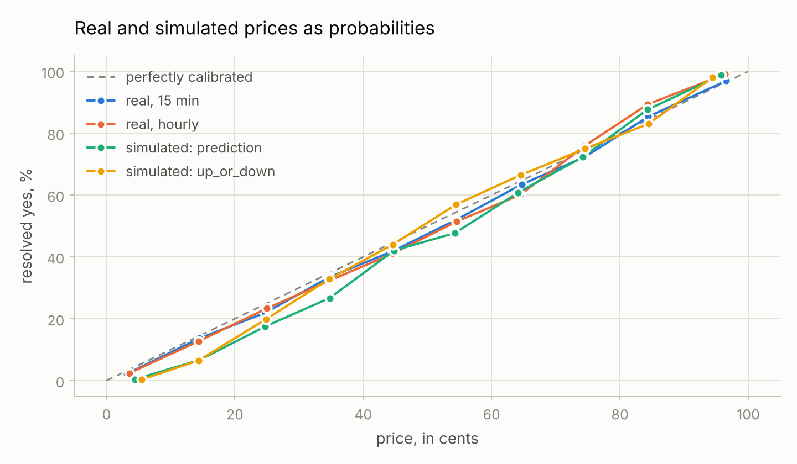

| price | real, 5 min: resolved yes | real, 15 min: resolved yes | real, hourly: resolved yes | simulated: prediction: resolved yes | simulated: up_or_down: resolved yes |
|---|---:|---:|---:|---:|---:|
| 0 to 10 | 2.3% (15827) | 2.2% (3797) | 2.4% (712) | 0.4% (740) | 0.3% (898) |
| 10 to 20 | 14.6% (5978) | 13.7% (1966) | 12.8% (431) | 6.7% (522) | 6.5% (585) |
| 20 to 30 | 24.9% (6181) | 22.0% (2191) | 23.4% (531) | 17.5% (629) | 19.9% (584) |
| 30 to 40 | 33.1% (6190) | 33.5% (2506) | 32.4% (725) | 26.7% (757) | 32.8% (811) |
| 40 to 50 | 44.2% (6440) | 41.9% (2856) | 41.1% (898) | 42.0% (1187) | 44.0% (945) |
| 50 to 60 | 55.2% (6714) | 52.0% (2945) | 51.5% (913) | 47.7% (1196) | 57.0% (1057) |
| 60 to 70 | 65.2% (6254) | 63.5% (2556) | 60.1% (722) | 60.8% (816) | 66.5% (814) |
| 70 to 80 | 74.2% (5710) | 72.3% (2311) | 75.8% (557) | 72.4% (590) | 75.0% (603) |
| 80 to 90 | 85.6% (5966) | 85.3% (2126) | 89.3% (458) | 87.6% (477) | 83.0% (548) |
| 90 to 100 | 97.6% (16801) | 97.0% (4087) | 99.1% (874) | 98.8% (686) | 98.0% (755) |

Moments from one question are alike, so they are worth far fewer independent forecasts than their
count, and a few hundred simulated questions resolve yes a few percent more or less than half the
time by chance, which moves the whole curve.

### What the real markets show

- **They are calibrated, with no favourite–longshot bias.** Of the moments priced 10 to 20, 13 to
  15% resolved yes; of those priced 80 to 90, 85 to 89%. The example's late traders hold its
  prices back from 0 and 100 (7% and 88%); these traders do not. The bias Snowberg and Wolfers
  (2010) describe is in betting on horses and on questions that run for months; questions that
  resolve in minutes, on a price anyone can watch, do not show it.
- **Prices keep up within a block or two.** The price is closest to the value as it was 1 to 3
  seconds before, about the time a trade takes to settle on the chain; the example's is closest
  to the value as it was 35 seconds before. Its followers a minute late are no real crowd's
  pace.
- **The prices forecast as well as the value worked out from Bitcoin, or better.** Their Brier
  score is 0.150 for fifteen minutes and 0.127 for five, against the value's 0.160 and 0.153:
  traders can watch the very price each question resolves on, of which this value is only a
  stand-in.
- **Prices move fastest at the end, while the question is open**, from 11 cents a fifteenth of
  the window to 39 to 48 in the last tenth, four times as fast, as in the example (from 8 to 26).
  For a question still open with a minute left, a small move in Bitcoin decides it.
- **Order sizes have a power-law tail.** The median order is 10 shares, the largest tenth start
  at seven times that, and the tail's exponent is about 1.4: an order a hundred times the median
  comes once in five hundred. The example's orders are all 1 to 10 lots.
- **Order signs remember.** A buy is followed by another buy more often than not: the signs of
  orders one apart correlate +0.23 to +0.30, ten apart +0.05 to +0.12. The example's correlate
  less than +0.1.
- **Successive price changes bounce**, a correlation of about −0.33 in the five- and
  fifteen-minute questions, as trades alternate between the bid and the ask: Roll's measure
  (1984) puts the spread at 3.2 to 3.5 cents, against the example's 1.2.

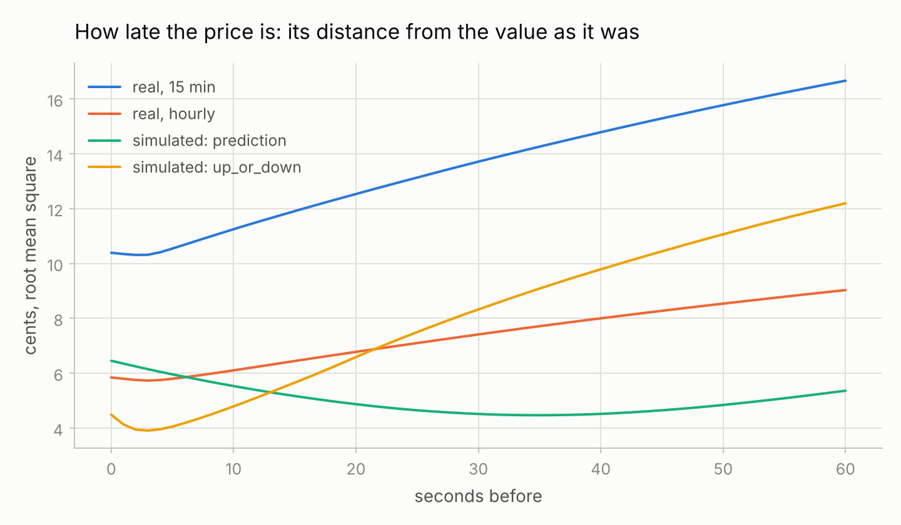

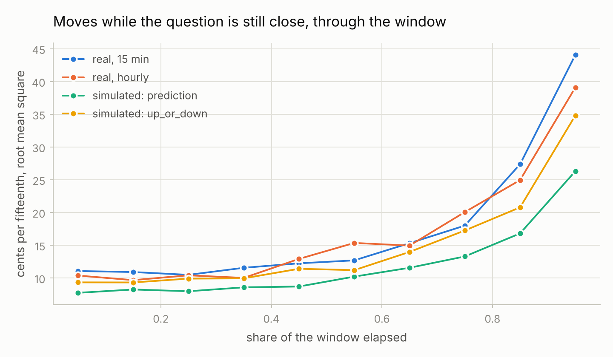

### Fees

Every real order that took liquidity paid a fee, and it is exactly 0.07·q·(1 − q) dollars a share
for a share priced q dollars. Over the 8.2 million fills of the fifteen days, the fee over
q·(1 − q) has a median of 0.0700 in every twentieth of the price range, in all three series, and
all but one fill in 2,000 paid it; summed, fees run 1 to 4% above the formula, as small fills'
fees are rounded up. It comes to 1.75 cents a share at 50 and a third of a cent below 5 or above
95. Crowdbook charges it with a fee curve: `taker_fee = 1.75` with `fee_curve = "probability"`
charges a fill at price p the fee times 4·q·(1 − q), for q = p ÷ 100. The fitted market charges it,
and its takers pay 1.40 cents a share against 1.13 in the real fifteen-minute questions, because
they trade nearer 50. No built-in agent looks at fees, so they change who profits and not how
anyone trades: the crowd's fitted thresholds stand in for the edge real traders wait for to cover
them.

The fitted market's noise traders also send market orders with a worst price, 10 cents past the
last trade (`market_protection`), as real market orders carry one. It leaves the scorecard as it
was, since simulated orders already moved the price past 10 cents more rarely than real ones, and
it keeps a maker quoting 30 cents from the price from making money on market orders that would run
up a one-sided book to its quotes, which it otherwise did.

### A market fitted to them

[up_or_down.toml](../examples/scenarios/up_or_down.toml) is a fifteen-minute question whose
settings [`crowdbook-fit`](../analysis/src/crowdbook_analysis/fit.py) chose, all eighteen at once,
to bring its scorecard closest to that of the fifteen-minute questions. The fit is the method of
simulated moments (McFadden, 1989):

- **Tolerances from sampling error.** Twenty-two statistics of the scorecard are compared, each
  over a tolerance: the spread of the real statistic over 100 resamples of the real questions and
  of the simulated one over resamples of 120 simulated questions, together. How far the price is
  from the value is left out, since part of it is the stand-in value's own error.
- **A joint search.** CMA-ES (Hansen, 2016) moves every setting at once, 80 generations of 12
  candidates, each judged on the same 120 seeds so that their differences are not noise.
- **Judged on other seeds**: 400 the search never used.
- **Uncertainties** from the sandwich formula of simulated moments: the statistics' derivatives
  with respect to the settings at the fit, by central differences on 400 common seeds, around the
  covariance of the real and simulated statistics.

| statistic | tolerance | M18: off by | fitted: off by |
|---|---:|---:|---:|
| value's moves in the first tenth | 0.503 | −8.0 | −7.8 |
| value's moves in the last tenth | 4.89 | +0.4 | +0.0 |
| excess kurtosis of the value's moves | 0.609 | +0.3 | +0.1 |
| Brier score | 0.0117 | +0.8 | +0.6 |
| priced 10 to 20: resolved yes | 0.0481 | −0.3 | −1.5 |
| priced 80 to 90: resolved yes | 0.0644 | −0.0 | −0.4 |
| moves in the first tenth | 0.467 | −2.6 | −3.7 |
| moves in the fifth tenth | 0.638 | −0.9 | −1.3 |
| moves in the last tenth | 3.41 | −3.2 | −2.7 |
| excess kurtosis of moves | 0.324 | −2.2 | −1.5 |
| last price below 10 or above 90 | 0.0275 | −4.3 | −2.8 |
| orders per minute | 4% | +12.9 | +6.4 |
| orders in the first tenth | 0.00381 | +9.7 | +7.2 |
| orders in the fifth tenth | 0.00392 | +5.8 | +5.2 |
| orders in the last tenth | 0.00769 | −8.0 | −6.6 |
| largest tenth of sizes against the median | 2% | −27.2 | −14.3 |
| tail exponent of sizes | 2% | −0.3 | −2.9 |
| order signs one apart | 0.00692 | +2.5 | +4.0 |
| order signs ten apart | 0.00492 | −2.0 | −2.6 |
| successive price changes | 0.00917 | −2.5 | +2.4 |
| spread implied | 4% | −12.2 | −2.8 |
| price closest to the value as it was | 0.273 | +3.7 | +3.7 |
| **distance** | | 1381 | 524 |

In tolerances, on 400 seeds the search never used; rates and ratios are compared as logarithms.
M18 is the market fitted one setting at a time, with the fee and the worst price added. The
distance falls from 1,381 to 524. On the search's own 120 seeds it was 277: a search that picks
the best of many candidates on the same seeds fits their noise too, which is why it is judged on
others.

| setting | M18 | fitted | 68% interval |
|---|---:|---:|---:|
| news_rate | 0.01 | 0.00879 | 0.00617 to 0.0125 |
| news_share | 0.05 | 0.18 | 0.109 to 0.297 |
| fast | 4 | 2 | 1.76 to 2.28 |
| fast_lag | 1 | 0.223 | 0.1 to 0.595, cut short by the range's edge |
| crowd | 10 | 37 | 32.9 to 40, cut short by the range's edge |
| crowd_lag | 10 | 9.24 | 5.03 to 17 |
| crowd_interval | 10 | 5.46 | 3.43 to 8.7 |
| crowd_noise | 1 | 1.47 | 0.329 to 6, cut short by the range's edge |
| crowd_threshold | 5 | 8.47 | 6.56 to 10.9 |
| crowd_error | 1 | 0.626 | 0.36 to 1.09 |
| informed_tail | 0.8 | 0.648 | 0.6 to 0.788, cut short by the range's edge |
| noise_rate | 0.005 | 0.00987 | 0.00737 to 0.0132 |
| limit_rate | 0.2 | 0.226 | 0.162 to 0.314 |
| size_tail | 1 | 0.988 | 0.902 to 1.08 |
| maker_intensity | 0.2 | 0.111 | 0.1 to 0.132, cut short by the range's edge |
| brokers | 2 | 0 | at the edge of its range |
| broker_interval_spread | 0 | 0.34 | not pinned down: no statistic moves with it here |
| broker_size_spread | 0 | 0.387 | not pinned down: no statistic moves with it here |

68% intervals from the sandwich formula; whole numbers are treated as if they could take any value
between. They count sampling error in the real statistics and the simulation's noise, not the ways
the simulated market differs from the real one. Five run into the edge of the range the search was
given, so the best point may lie beyond it and those intervals are only a guide: the next fit
widens those ranges. The fit chose no brokers, so their spreads move nothing and nothing pins them
down. What it chose:

- **News carries more of the uncertainty**, 18% of it against 5%, and the value's late moves and
  their tails are the real ones: 41.7 cents a fifteenth in the last tenth against 41.6, and excess
  kurtosis 2.2 against 2.1, on the scorecard's 400 seeds.
- **Two fast traders a fifth of a second late, and a crowd of 37** looking every five seconds about
  nine seconds late, waiting for 8.5 cents of edge. The price is closest to the value as it was 3
  seconds before, against 2 in the real markets.
- **No brokers.** The crowd's own orders give order signs the real memory, +0.33 one apart and
  +0.11 ten apart against +0.30 and +0.12.
- **A market maker quoting wider and more market orders from noise traders** widen the spread to
  2.9 cents against 3.2, from 2.0 one setting at a time, and the bounce is the real one, −0.30
  against −0.32.
- **Prices go further at the end**: 92% of questions last trade below 10 or above 90, from 81%,
  against nearly all real ones; and the pace is 89 orders a minute against 71, from 112.

### How far the statistics move with the settings

Each setting drawn a third either way of the fit, 40 draws each scored on 80 seeds: the 5th to 95th
percentile of each statistic over the draws, and how often a draw lands within two tolerances of the
real value.

| statistic | real | fitted | 5th to 95th percentile over the draws | within two tolerances |
|---|---:|---:|---:|---:|
| value's moves in the first tenth | 14.2 | 9.67 | 9.68 to 9.89 | 0% |
| value's moves in the last tenth | 41.6 | 35.9 | 32.4 to 48.5 | 100% |
| excess kurtosis of the value's moves | 2.09 | 0.953 | 1.1 to 2.78 | 98% |
| Brier score | 0.15 | 0.17 | 0.159 to 0.181 | 30% |
| priced 10 to 20: resolved yes | 0.137 | 0.136 | 0.0713 to 0.248 | 85% |
| priced 80 to 90: resolved yes | 0.853 | 0.955 | 0.931 to 1 | 65% |
| moves in the first tenth | 11.1 | 9.1 | 6.63 to 9.85 | 2% |
| moves in the fifth tenth | 12.2 | 9.77 | 7.93 to 11.6 | 20% |
| moves in the last tenth | 44.1 | 31.2 | 24.2 to 40.5 | 15% |
| excess kurtosis of moves | 2.96 | 0.879 | 1.06 to 3.49 | 30% |
| last price below 10 or above 90 | 0.998 | 0.875 | 0.747 to 0.912 | 0% |
| orders per minute | 70.9 | 96.3 | 74.4 to 137 | 8% |
| orders in the first tenth | 0.0814 | 0.101 | 0.0868 to 0.104 | 12% |
| orders in the fifth tenth | 0.0787 | 0.0908 | 0.0892 to 0.0959 | 0% |
| orders in the last tenth | 0.15 | 0.103 | 0.1 to 0.116 | 0% |
| largest tenth of sizes against the median | 7.14 | 5.4 | 4.79 to 10.7 | 15% |
| tail exponent of sizes | 1.39 | 1.28 | 1.06 to 1.52 | 22% |
| order signs one apart | 0.3 | 0.33 | 0.237 to 0.543 | 12% |
| order signs ten apart | 0.12 | 0.116 | 0.0418 to 0.342 | 12% |
| successive price changes | −0.324 | −0.321 | −0.354 to −0.247 | 42% |
| spread implied | 3.23 | 3.12 | 1.33 to 4.44 | 22% |
| price closest to the value as it was | 2 | 3 | 2 to 13.2 | 28% |

Some statistics hardly move whatever the settings: the value's early moves, the last price at the
end, the share of orders in the middle and last tenths of the window. Those are where the model,
not its settings, falls short. Others move a long way with settings a third off, the lateness of
the price and the memory in order signs among them, so the fitted point matters for them.

### Where the fit falls short

- **Cheap and dear shares are mispriced at the ends.** Of the moments priced 10 to 20, 6.5%
  resolve yes against 13.7%, and of those priced 0 to 10, 0.3% against 2.2%: a favourite–longshot
  bias the real markets do not have and the market fitted one setting at a time did not (16.5%).
  The joint search traded it for the spread, the pace and the close, since few moments fall at
  the ends and their tolerances are wide. Betting on the bias does not pay after spread and fees,
  though: over 400 markets with these settings drawn within a third either way, a trader buying
  shares priced 80 to 97 and selling those priced 3 to 20, holding them to the end, made −0.72
  dollars a market, with a 95% interval from −2.36 to +0.93.
- **Orders do not crowd in at the end.** In the real fifteen-minute questions the last tenth of the
  window has 15% of the orders and the first tenth 8%; the fitted market has 10% and 11%. Nothing
  in the simulated crowd is drawn to a question as its fate is decided.

  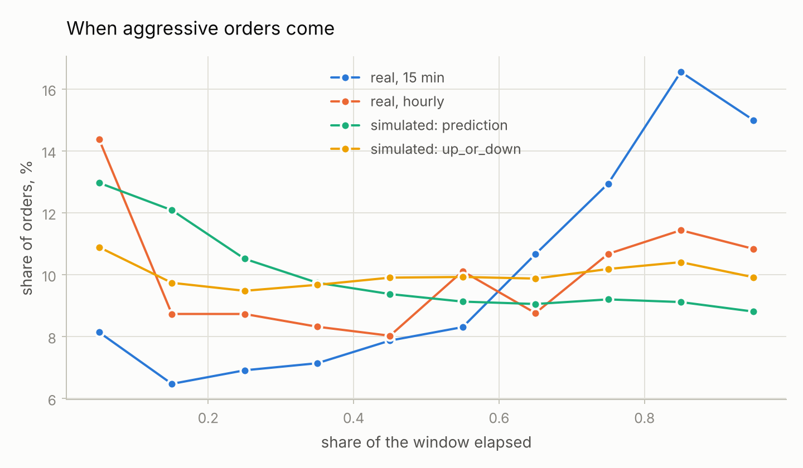

- **Still too many orders**, 89 a minute against 71.
- **Prices still do not go all the way at the end**, 92% of questions against nearly all, and moves
  late in the window are smaller than the real ones, 35 cents a fifteenth against 44. Real trading
  stops a median of twenty seconds before the end, once the price is there; simulated trading goes
  on to the last second.
- **The value moves less early in the window**, 10 cents a fifteenth against 14. A simulated
  question's uncertainty is the same in every run; Bitcoin is calmer in some windows than the
  hour before and wilder in others, which the stand-in value does not know, so its early moves
  are partly that difference.

### Limitations

- **Trades, not the book.** Spreads, depth and the size of quotes are what the chain does not
  record; the book is published only through Polymarket's own service.
- **One asset, one kind of question, two weeks.** Questions about Bitcoin's next few minutes all
  follow one price that anyone can watch; elections and games, traded for months, are another
  market, and the one where the favourite–longshot bias has been found.
- **The value is a stand-in.** It ignores the minute's averaging the shorter questions resolve on
  and the moves within each hour's volatility, so the distance between price and value is partly
  the stand-in's error: 4 cents for hourly questions, 7 for fifteen minutes, 14 for five.
- **Times are when trades settled**, a second or two after they matched, so the real market's
  lateness is at most what is shown and may be less. Most orders share their block's time with
  another order in the same question, 86% for fifteen minutes and 97% for five, so the order of
  orders within a block is the order in which they settled, and the memory in order signs is
  measured at that resolution.
- **Shares against lots.** Real order sizes are in shares, which a fixed amount of money buys more
  of at low prices; simulated sizes are lots, whatever the price. The matching tail exponents may
  partly compare different things.
- **Sampling error, not misspecification.** The settings' intervals say how much they could move by
  chance. Where no setting brings a statistic to the real one, as for the value's early moves or
  the crowding at the end, the model itself falls short, and the intervals do not say so.

## Market-maker experiments

These use a smaller market, so many seeds are cheap. Each point averages 32 runs of 60 seconds.
Each run has twenty noise traders with one market order a second each, plus an Avellaneda–Stoikov
market maker (Avellaneda and Stoikov, 2008).

### Self-impact: skewing quotes moves the market

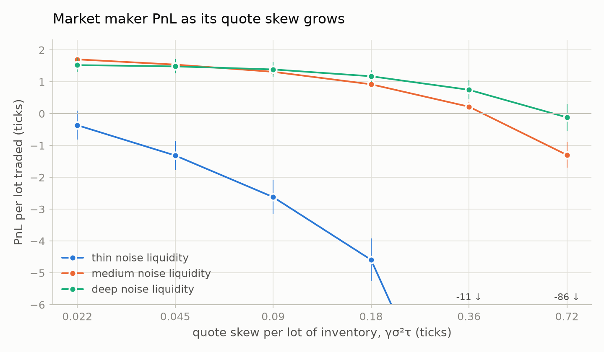

The noise traders anchor their limit prices on the best quotes, which are often the market
maker's own. When it skews its quotes against its inventory, it moves the market against itself.
PnL per lot falls as the skew per lot of inventory (γσ²τ) grows. It falls faster the less
liquidity the noise traders post themselves (0.5, 1 or 2 limit orders a second each):

| Skew per lot | Thin | Medium | Deep |
|---:|---:|---:|---:|
| 0.022 | −0.36 ± 0.45 | +1.70 ± 0.12 | +1.52 ± 0.22 |
| 0.045 | −1.31 ± 0.46 | +1.54 ± 0.09 | +1.48 ± 0.22 |
| 0.09 | −2.62 ± 0.54 | +1.31 ± 0.10 | +1.39 ± 0.23 |
| 0.18 | −4.59 ± 0.68 | +0.92 ± 0.12 | +1.17 ± 0.18 |
| 0.36 | −11.4 ± 3.7 | +0.22 ± 0.14 | +0.75 ± 0.30 |
| 0.72 | −86 ± 20 | −1.30 ± 0.40 | −0.12 ± 0.43 |

The default skew of 0.045 sits in the safe region for medium and deep markets. In a thin market
the maker loses at every skew: its own quotes are the market.

### Who pays for informed trading

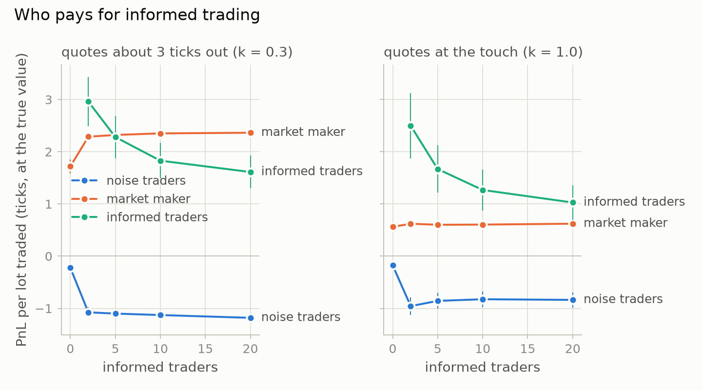

The textbook expects informed traders to cost the market maker (Glosten and Milgrom, 1985). Here
its PnL per lot does not fall as informed traders are added. That holds whether it quotes wide
(intensity k = 0.3, about 3 ticks from its fair price) or at the touch (k = 1.0). The true value is
a random walk of 4 ticks per √second.

| Maker's quotes | Informed traders | Maker at 20 µs | Maker at 5 ms | Noise traders | Informed traders |
|---|---:|---:|---:|---:|---:|
| Wide | 0 | +1.72 ± 0.14 | +1.81 ± 0.14 | −0.22 ± 0.02 | — |
| Wide | 2 | +2.29 ± 0.03 | +2.26 ± 0.03 | −1.08 ± 0.10 | +2.96 ± 0.47 |
| Wide | 20 | +2.36 ± 0.03 | +2.25 ± 0.03 | −1.18 ± 0.09 | +1.61 ± 0.31 |
| At the touch | 0 | +0.56 ± 0.02 | +0.59 ± 0.02 | −0.18 ± 0.01 | — |
| At the touch | 2 | +0.62 ± 0.02 | +0.56 ± 0.02 | −0.96 ± 0.17 | +2.50 ± 0.62 |
| At the touch | 20 | +0.62 ± 0.01 | +0.47 ± 0.01 | −0.84 ± 0.15 | +1.03 ± 0.34 |

The maker is still adversely selected. The markouts below show how the mid moves in the maker's
favour after each of its fills, split by who took the other side, at a 20 µs connection:

| Maker's quotes | Informed traders | Other side | Share of maker's lots | 1 ms | 1 s | 10 s |
|---|---:|---|---:|---:|---:|---:|
| Wide | 0 | Noise | 100% | +2.33 | +1.94 ± 0.05 | +1.36 ± 0.15 |
| Wide | 20 | Informed | 23% | +2.67 | −0.99 ± 0.09 | −0.90 ± 0.32 |
| Wide | 20 | Noise | 77% | +2.86 | +3.33 ± 0.04 | +3.29 ± 0.09 |
| At the touch | 0 | Noise | 100% | +0.97 | +0.54 ± 0.02 | +0.51 ± 0.02 |
| At the touch | 20 | Informed | 37% | +0.97 | −0.85 ± 0.05 | −0.89 ± 0.17 |
| At the touch | 20 | Noise | 63% | +1.09 | +1.49 ± 0.03 | +1.45 ± 0.10 |

Within a second, the maker's fills against informed traders are losing about 0.9 ticks per lot.
But the same informed traders pull the price back to value after noise orders push it away. The
maker took the other side of those noise orders, so it collects that reversion. At the touch, its
fills against noise traders earn +1.45 a lot with informed traders around, against +0.51 without
them.

The two effects roughly cancel, and the informed traders more than double the maker's volume. The noise
traders pay for both. Glosten–Milgrom has a single liquidity provider. Here a crowd posts liquidity
too, and informed traders also correct the noise traders' mistakes.

Two smaller effects show in the table:
- A slow maker suffers a little more. At the touch on a 5 ms connection, its PnL per lot falls
  from +0.59 to +0.47 as informed traders are added; at 20 µs it does not fall.
- Informed traders compete away their own edge: profit per lot falls from 2.96 with two of them
  to 1.61 with twenty.

`crowdbook-experiments` prints the full tables, including the 500 µs latency and every count of
informed traders.

## What the analysis caught

Measuring the markets found six modelling problems, each fixed before the results above:

1. **Cancellation per trader.** Zero-intelligence traders first cancelled their own orders at a
   fixed rate per trader. The book grew without limit, from 4,500 to 12,500 resting orders in ten
   minutes, and the stale orders pinned the price for hours. Each order now has its own
   exponential lifetime, and the book holds steady near a thousand orders.
2. **Lockstep timers.** All twenty informed traders woke at exactly the same instants, so they hit
   the book as one burst five times a second. The impact measurement showed the price still moving
   within a millisecond of an informed order. Timers now start at a random point in their first
   interval.
3. **Informed traders out of capacity.** Holding the price to the true value means absorbing the
   noise traders' net order flow, which wanders like a random walk. With limits of 100 lots each,
   the informed traders filled up within half an hour. By the end of a day the price was up to 780
   ticks from the value. With those limits the mixed market showed fat tails at one minute (excess
   kurtosis +1.27 ± 0.30), but they were an artifact of the drifting price. With larger limits and a calmer
   value, they are gone.
4. **Idle agents.** Once the informed traders anchored the price, the trend followers' two-tick
   trends almost never formed, and the market maker's quotes, three ticks out, were almost never
   reached. Both were retuned until every type of agent trades. The settings are in the scenario
   file.

5. **Traders who knew too much.** Informed traders first saw the true value with fresh noise on
   each look, so between them they knew it exactly: the prediction market came out calibrated by
   construction, and the price never strayed from the value for long. Each trader now sees it
   late, by a delay of its own, with a lasting error and, for some, a tilt.
6. **A crowd too small for a day.** The first crowd of experts and followers, five and 120 on
   limits of 500 lots, filled up within half a day of the memory market. Its price then drifted up
   to 46 ticks from the value, and the drift looked like strong volatility clustering, +0.6 at a
   minute. Ten experts on 5,000 lots and 400 followers on 1,000 hold the price within about a
   tick of the value all day under every seed.

The fourth is a choice, not a bug. The results above hold for these settings, and other settings
give other markets. Making that easy to explore is the point of the toolkit.

## Limitations and next steps

- Volatility clusters for about an hour in the memory market, where in real markets it lasts
  weeks; no agent here remembers longer than a day.
- Each scenario is one point in a large parameter space, chosen so that every type of agent
  trades. The scripts make sweeps cheap.
- Only [up_or_down.toml](../examples/scenarios/up_or_down.toml) is fitted to real markets, and
  only to their trades; the other markets here are not calibrated, and nothing is yet fitted to
  a real order book.
- One instrument, no hidden orders, and an exchange that takes no time to process a message.
- The trading day's open is no more volatile than its midday: nothing here brings news at the
  open, and nobody but the noise traders trades in the auctions.
- Impact and markouts are measured on the mid, so they miss changes in depth behind the best
  prices.

## References

- Andersen, T., Bollerslev, T., Diebold, F. and Labys, P. (2000). Great realizations. *Risk* 13,
  105–108.
- Avellaneda, M. and Stoikov, S. (2008). High-frequency trading in a limit order book.
  *Quantitative Finance* 8(3), 217–224.
- Bouchaud, J.-P., Farmer, J. D. and Lillo, F. (2009). How markets slowly digest changes in supply
  and demand. In *Handbook of Financial Markets: Dynamics and Evolution*, 57–160. North-Holland.
- Brock, W. and Hommes, C. (1998). Heterogeneous beliefs and routes to chaos in a simple asset
  pricing model. *Journal of Economic Dynamics and Control* 22(8–9), 1235–1274.
- Cont, R. (2001). Empirical properties of asset returns: stylized facts and statistical issues.
  *Quantitative Finance* 1(2), 223–236.
- Donier, J., Bonart, J., Mastromatteo, I. and Bouchaud, J.-P. (2015). A fully consistent,
  minimal model for non-linear market impact. *Quantitative Finance* 15(7), 1109–1121.
- Farmer, J. D., Patelli, P. and Zovko, I. (2005). The predictive power of zero intelligence in
  financial markets. *PNAS* 102(6), 2254–2259.
- Glosten, L. and Milgrom, P. (1985). Bid, ask and transaction prices in a specialist market with
  heterogeneously informed traders. *Journal of Financial Economics* 14(1), 71–100.
- Hansen, N. (2016). The CMA evolution strategy: a tutorial. arXiv:1604.00772.
- Hill, B. (1975). A simple general approach to inference about the tail of a distribution.
  *Annals of Statistics* 3(5), 1163–1174.
- Hong, H. and Stein, J. (1999). A unified theory of underreaction, momentum trading, and
  overreaction in asset markets. *Journal of Finance* 54(6), 2143–2184.
- Kyle, A. (1985). Continuous auctions and insider trading. *Econometrica* 53(6), 1315–1335.
- Lillo, F., Mike, S. and Farmer, J. D. (2005). Theory for long memory in supply and demand.
  *Physical Review E* 71, 066122.
- McFadden, D. (1989). A method of simulated moments for estimation of discrete response models
  without numerical integration. *Econometrica* 57(5), 995–1026.
- Roll, R. (1984). A simple implicit measure of the effective bid-ask spread in an efficient
  market. *Journal of Finance* 39(4), 1127–1139.
- Snowberg, E. and Wolfers, J. (2010). Explaining the favorite–long shot bias: is it risk-love
  or misperceptions? *Journal of Political Economy* 118(4), 723–746.
- Tóth, B., Lempérière, Y., Deremble, C., de Lataillade, J., Kockelkoren, J. and Bouchaud, J.-P.
  (2011). Anomalous price impact and the critical nature of liquidity in financial markets.
  *Physical Review X* 1, 021006.
